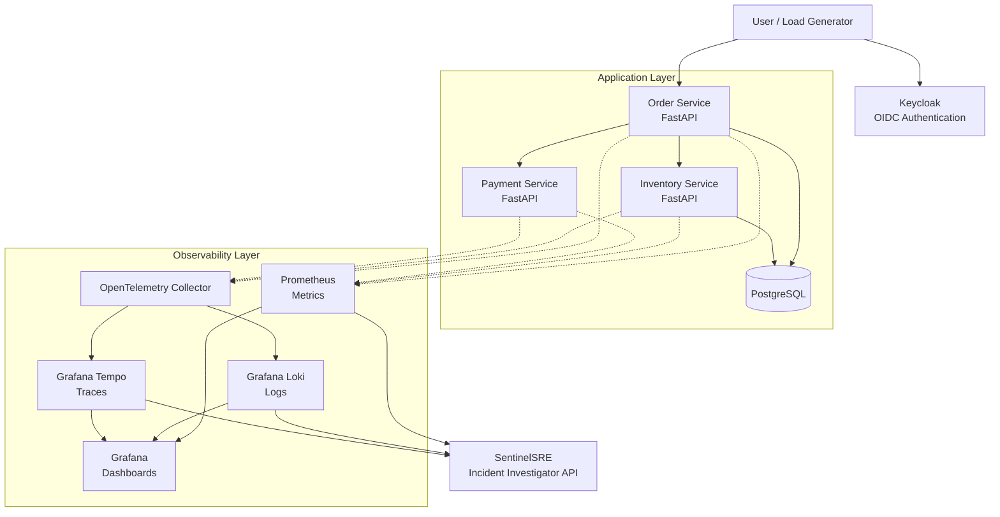

# 🛡️ SentinelSRE

### Predictive SRE Incident Investigator

**Evidence-driven incident detection, observability, and troubleshooting for distributed microservices**

<p align="center">
  <b>Monitor. Detect. Investigate. Understand.</b>
</p>

<p align="center">
  <a href="#-overview">Overview</a> ·
  <a href="#-features">Features</a> ·
  <a href="#-architecture">Architecture</a> ·
  <a href="#-dashboard-screenshots">Screenshots</a> ·
  <a href="#-installation">Setup</a> ·
  <a href="#-usage">Usage</a> ·
  <a href="#-incident-investigation">Investigation</a>
</p>

<p align="center">
  
  
  
  
  
  
  
  
</p>

---

## 📌 Overview

**SentinelSRE** is a local-first Site Reliability Engineering (SRE) platform that demonstrates how modern engineering teams can monitor distributed microservices, identify abnormal service behavior, and investigate potential incidents using metrics, logs, and distributed traces.

The platform simulates a real-world e-commerce order processing system consisting of independent Order, Inventory, and Payment microservices, backed by PostgreSQL and protected through Keycloak authentication.

It integrates a complete observability ecosystem using Prometheus, OpenTelemetry, Grafana Loki, Grafana Tempo, and Grafana dashboards.

At its core, SentinelSRE features an **Incident Investigator Engine** that compares current service latency against historical baselines, collects relevant telemetry evidence, identifies potentially affected services, and generates structured incident investigation reports containing ranked service leads, uncertainties, and recommended diagnostic checks.

The environment runs entirely on a developer's local machine using Docker Compose and generates its own traffic and telemetry without requiring a training dataset or paid monitoring services.

> **Detection approach:** The current implementation uses a statistical latency-baseline detector based on recent historical samples and a median threshold. It does not currently use a trained machine-learning model.

## ✨ Features

- 🏗️ **Microservices Architecture:** Distributed Order, Inventory, and Payment services built using Python and FastAPI.
- 📊 **Real-Time Observability:** Collects application metrics, logs, and distributed traces.
- 🔍 **Latency Anomaly Detection:** Identifies abnormal response times using historical latency baselines.
- 🧠 **Incident Investigation Engine:** Combines metrics, logs, and traces to generate evidence-driven investigation reports.
- 🎯 **Ranked Service Leads:** Identifies potentially affected services based on collected telemetry.
- ⚡ **Fault Injection:** Simulates inventory-service latency and error scenarios to demonstrate service degradation.
- 📈 **Grafana Dashboards:** Visualizes request rates, service health, latency, HTTP 5xx responses, and error logs.
- 🔐 **Authentication and Authorization:** Integrates Keycloak with OpenID Connect (OIDC) for local identity management.
- 🗄️ **Persistent Storage:** Uses PostgreSQL for application and inventory data.
- 🧪 **Automated Testing:** Includes unit and integration tests using Pytest.
- 🐳 **Containerized Environment:** Runs the complete application and observability stack through Docker Compose.
- 💻 **Local-First Deployment:** No paid SaaS monitoring platform or external payment provider required.

---

## 🏗️ Architecture

SentinelSRE follows a distributed microservices architecture with a centralized observability and investigation layer.

### System Architecture



### Application Workflow

1. The user authenticates through Keycloak.
2. An authenticated order request reaches the Order Service.
3. The Order Service communicates with the Inventory Service to check and reserve stock.
4. The Payment Service processes a simulated payment approval.
5. PostgreSQL stores application and inventory information.
6. Each microservice generates metrics, logs, and distributed traces.
7. Prometheus collects metrics, while the OpenTelemetry Collector receives telemetry.
8. Loki and Tempo store logs and traces respectively.
9. Grafana visualizes the collected telemetry.
10. The SentinelSRE Investigator API analyzes the telemetry and generates an incident report.

---

## 🛠️ Technology Stack

| Category | Technologies | Purpose |
|---|---|---|
| Backend | Python, FastAPI | Microservices and REST APIs |
| Containerization | Docker, Docker Compose | Service orchestration |
| Database | PostgreSQL | Persistent application storage |
| Authentication | Keycloak, OIDC | Identity and access management |
| Metrics | Prometheus | Metrics collection and querying |
| Telemetry | OpenTelemetry Collector | Telemetry ingestion |
| Logging | Grafana Loki | Centralized log storage |
| Distributed Tracing | Grafana Tempo | Trace storage |
| Visualization | Grafana | Observability dashboards |
| Testing | Pytest | Unit and integration testing |
| Traffic Generation | Python | Automated order requests |
| Fault Injection | Python | Controlled failure scenarios |

---

## 📸 Dashboard Screenshots

### Grafana – SRE Service Overview

The Grafana dashboard provides a centralized view of the microservices environment, allowing users to monitor application health and identify service degradation.

<p align="center">
  
</p>

<p align="center">
  <i>SentinelSRE – Grafana SRE Service Overview</i>
</p>

### Dashboard Monitoring Capabilities

| Dashboard Panel | Description |
|---|---|
| Service Scrape Health | Monitors the availability of application services |
| Request Rate | Displays incoming HTTP requests over time |
| Request Latency | Tracks service response times |
| HTTP 5xx Responses | Identifies server-side errors |
| Service Error Logs | Displays ERROR and FATAL log records |

---

## 🧠 Incident Investigation Engine

The Incident Investigator is the core analytical component of SentinelSRE.

It evaluates service behavior against recent historical latency measurements and retrieves supporting telemetry to help identify potential causes of service degradation.

### 1. Baseline Establishment

The system collects recent request latency samples during normal application operation and establishes a historical median latency baseline.

### 2. Anomaly Detection

Current latency is compared against the historical baseline using a configured threshold.

Abnormal deviations are flagged for further investigation.

### 3. Multi-Source Evidence Collection

The investigator collects telemetry from three primary sources:

| Source | Evidence Collected |
|---|---|
| Prometheus | Request metrics and latency measurements |
| Grafana Loki | Application logs and service errors |
| Grafana Tempo | Distributed traces |

### 4. Service Lead Identification

The collected evidence is used to identify potentially affected services and rank investigation leads.

### 5. Incident Report Generation

The Investigator API returns a structured report containing:

- Detection status.
- Current latency measurements.
- Historical latency baseline.
- Supporting telemetry evidence.
- Ranked service leads.
- Investigation uncertainties.
- Recommended diagnostic checks.

### Detection Status

| Status | Meaning |
|---|---|
| `normal` | No latency anomaly identified |
| `anomaly` | Abnormal latency detected against the baseline |
| `insufficient_data` | Not enough historical telemetry to establish a reliable baseline |

The system explicitly reports insufficient data rather than making unsupported diagnoses.

The investigator provides diagnostic recommendations but does not automatically remediate services.

---

## ⚡ Fault Injection & Failure Simulation

SentinelSRE includes a controlled fault injection mechanism to simulate service failures and observe their impact across the distributed application.

### Available Fault Scenarios

| Scenario | Description | Expected Observation |
|---|---|---|
| `inventory_latency_01` | Introduces artificial latency into the Inventory Service | Increased request latency |
| `inventory_error_01` | Introduces inventory-service error responses | Service errors and HTTP 5xx responses |

### Fault Injection Workflow

1. Establish a normal latency baseline.
2. Start continuous order traffic.
3. Inject a controlled fault into the Inventory Service.
4. Observe changes in service response times.
5. Monitor HTTP 5xx responses and error logs in Grafana.
6. Run the SentinelSRE Investigator while the fault is active.
7. Examine the investigation report and supporting evidence.

The fault injector restores the Inventory Service's default configuration after the scenario completes.

**Note:** Fault injection recreates a local container, which can cause a brief service interruption during restart.

---

## 🚀 Installation

### Prerequisites

Ensure the following are installed:

- Docker Desktop with Docker Compose.
- Python 3.11 or newer.
- PowerShell (for the commands below).
- Internet connection for downloading container images.

### 1. Clone the Repository

```bash
git clone https://github.com/kruthigr-gif/SentinelSRE.git
cd SentinelSRE
```

*Replace the repository URL and folder name if you choose a different GitHub repository name.*

### 2. Create a Virtual Environment

```powershell
python -m venv .venv
```

Activate the environment:

```powershell
.\.venv\Scripts\Activate.ps1
```

### 3. Install Dependencies

```powershell
python -m pip install -r requirements.txt
```

### 4. Start the Application

```powershell
python .\scripts\start_local.py
```

The startup script launches the Docker Compose environment and creates the required local sign-in accounts.

Generated secrets are stored in the ignored `.env` file on your machine.

**Never commit or share your `.env` file.**

### 5. Verify Running Containers

```powershell
docker compose ps
```

---

## 🌐 Service Endpoints

After successfully starting the environment, access the following services:

| Component | Local Endpoint |
|---|---|
| Order Service API | http://localhost:8000/docs |
| Inventory Service API | http://localhost:8001/docs |
| Payment Service API | http://localhost:8002/docs |
| Investigator API | http://localhost:9000/docs |
| Grafana | http://localhost:3000 |
| Keycloak Admin | http://localhost:8081/admin |
| Prometheus | http://localhost:9090 |
| Loki | http://localhost:3100 |
| Tempo | http://localhost:3200 |

The OpenTelemetry Collector accepts:

- OTLP gRPC: `4317`
- OTLP HTTP: `4318`

Grafana and Keycloak use separate local accounts. Use the credentials generated by your local setup.

---

## 💻 Usage

### 1. Run the Order Workflow

Open:

http://localhost:8000/docs

1. Authorize using your local authentication setup if prompted.
2. Expand `POST /orders`.
3. Click **Try it out**.
4. Enter the following request:

```json
{
  "item_id": "itemA",
  "quantity": 1
}
```

5. Click **Execute**.

A successful request returns HTTP `200` with:

```json
{
  "status": "order_created"
}
```

The demo inventory items start with local stock. Each successful order reserves stock.

To restore the inventory:

```powershell
docker compose exec -T postgres psql -U sre -d sre -c "UPDATE inventory SET stock=10000 WHERE item_id IN ('itemA','itemB');"
```

### 2. Generate Live Traffic

The project includes an authenticated Python load generator that sends automated order requests to the application.

```powershell
& .\.venv\Scripts\python.exe .\loadgen\run_load.py --rps 2 --duration 60
```

Parameters:

| Parameter | Description |
|---|---|
| `--rps 2` | Approximately 2 requests per second |
| `--duration 60` | Traffic generation for 60 seconds |

Open Grafana and navigate to the **SRE Service Overview** dashboard.

For better visibility, select **Last 5 minutes** or **Last 1 hour**.

You can also check service health directly through Prometheus:

```promql
up
```

Example order request-rate query:

```promql
sum(rate(http_requests_total{job="order-service", handler="/orders"}[1m]))
```

---

## 🔬 Incident Investigation

To perform an investigation, first establish a latency baseline using normal application traffic.

### Step 1: Generate Baseline Traffic

Run the load generator for approximately six minutes:

```powershell
& .\.venv\Scripts\python.exe .\loadgen\run_load.py --rps 2 --duration 360
```

Allow the command to complete.

### Step 2: Open the Investigator API

Navigate to:

http://localhost:9000/docs

Authorize using your local authentication setup if prompted.

### Step 3: Submit an Investigation Request

Expand `POST /investigate` and submit:

```json
{
  "alert_time": "<current UTC timestamp>",
  "service": "order-service",
  "window_seconds": 300
}
```

Replace the timestamp with the current UTC time.

Generate the timestamp using PowerShell:

```powershell
(Get-Date).ToUniversalTime().ToString("yyyy-MM-ddTHH:mm:ssZ")
```

### Step 4: Analyze the Report

The investigator returns:

- Detection status.
- Current and baseline latency.
- Telemetry evidence references.
- Ranked service leads.
- Investigation uncertainties.
- Recommended diagnostic checks.

If the report returns `insufficient_data`, generate additional traffic and retry with a new current timestamp.

---

## 🧪 Fault Injection Demonstration

To observe how a failure propagates through the application, run traffic generation and fault injection simultaneously.

### Terminal 1 – Generate Traffic

```powershell
& .\.venv\Scripts\python.exe .\loadgen\run_load.py --rps 2 --duration 150
```

### Terminal 2 – Inject Inventory Latency

```powershell
& .\.venv\Scripts\python.exe .\faults\inject.py inventory_latency_01
```

The scenario introduces temporary latency into the Inventory Service and restores its default configuration when completed.

Run an investigation while the fault is active.

To demonstrate error responses instead:

```powershell
& .\.venv\Scripts\python.exe .\faults\inject.py inventory_error_01
```

Observe the resulting changes through Grafana and the Investigator API.

---

## ✅ Testing

The project uses Pytest for automated testing.

Ensure the local environment is running and authentication is configured.

Execute:

```powershell
& .\.venv\Scripts\python.exe -m pytest -q
```

The test suite includes:

- Unit tests for application and investigation logic.
- Integration tests for the running services.
- An authenticated investigation API test using the local Keycloak user.

---

## 📁 Project Structure

```text
SentinelSRE/
│
├── benchmark/       # End-to-end baseline and fault benchmark
│
├── faults/          # Fault scenario definitions and injector
│
├── grafana/         # Dashboard JSON and datasource provisioning
│
├── investigator/    # Detection, evidence collection,
│                    # diagnosis, and investigation API
│
├── keycloak/        # Local OIDC realm configuration
│
├── loadgen/         # Authenticated order traffic generator
│
├── Screenshots/     # Grafana dashboard screenshots
│
├── scripts/         # Local setup and account provisioning
│
├── services/        # Order, Inventory, and Payment APIs
│
├── tests/           # Unit and integration tests
│
├── docker-compose.yml
├── requirements.txt
└── README.md
```

---

## 🛑 Stopping & Resetting

### Stop Containers

```powershell
docker compose down
```

This stops the containers while preserving named-volume data.

### Restart the Environment

```powershell
& .\.venv\Scripts\python.exe .\scripts\start_local.py
```

### Complete Reset

```powershell
docker compose down -v
```

**Warning:** This permanently deletes local named-volume data, including PostgreSQL, Prometheus, Loki, Tempo, and Keycloak state.

Only use this command when you intend to reset the complete environment.

---

## 🔐 Security & Limitations

SentinelSRE is designed for local development, experimentation, and educational demonstrations.

- **Local execution:** Compose binds application ports to `127.0.0.1`. Do not expose services through public IPs, tunnels, routers, or reverse proxies.
- **Development authentication:** Keycloak runs in development mode and is not configured for production identity management.
- **Simulated payments:** No real payment provider is contacted and no money is transferred.
- **No real customer data:** Do not use personal, customer, or payment-card information.
- **No automatic remediation:** The Investigator API generates reports and diagnostic recommendations but does not automatically repair services.
- **Local telemetry:** Named volumes provide persistence, not disaster recovery, backups, or high availability.
- **Not production-ready:** The platform is intended for learning and local demonstrations.
- **Resource consumption:** The software is free to run locally but uses computer resources, storage, electricity, and internet bandwidth.
- **Kubernetes examples:** Optional `k8s/` files are examples and are not a production-ready deployment.

---

## 🎯 Learning Outcomes

Through SentinelSRE, the project demonstrates practical concepts in:

- Distributed systems and microservices architecture.
- REST API development using FastAPI.
- Containerization and orchestration using Docker Compose.
- Authentication and authorization using Keycloak and OIDC.
- Metrics monitoring using Prometheus.
- Centralized logging using Grafana Loki.
- Distributed tracing using Grafana Tempo and OpenTelemetry.
- Observability dashboards using Grafana.
- Statistical latency anomaly detection.
- Evidence-driven incident investigation.
- Controlled fault injection and failure analysis.
- Automated unit and integration testing.

---

## 🔮 Future Enhancements

Potential extensions to SentinelSRE include:

- Machine-learning-based anomaly detection using historical telemetry.
- Advanced cross-service root cause analysis.
- Automated correlation of metrics, logs, and traces.
- Additional fault scenarios for database and payment-service failures.
- Alert notifications and incident timelines.
- Automated remediation with safety controls.
- Kubernetes-based deployment.
- Historical incident analytics and reliability reporting.

---

## 👩‍💻 Project Details

**Project Name:** SentinelSRE  
**Project Type:** Site Reliability Engineering & Observability Platform  
**Core Focus:** Predictive Anomaly Detection and Incident Investigation  
**Architecture:** Distributed Microservices  
**Backend:** Python, FastAPI  
**Deployment:** Docker Compose  
**Monitoring:** Prometheus, Grafana  
**Telemetry:** OpenTelemetry, Loki, Tempo  
**Database:** PostgreSQL  

**Built to explore how modern SRE practices, distributed observability, and evidence-driven troubleshooting can improve the understanding and reliability of microservices systems.**

---

<p align="center">
  <b>🛡️ SentinelSRE — Making Distributed System Failures Observable and Investigable.</b>
</p>

<p align="center">
  ⭐ If you find this project interesting, consider starring the repository!
</p>
